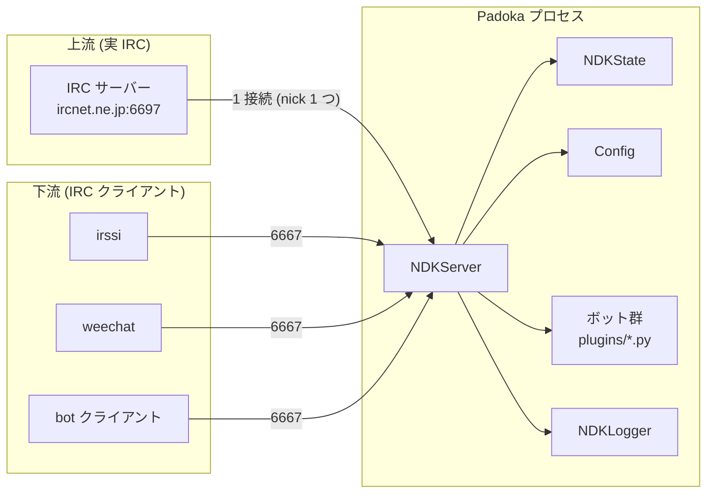
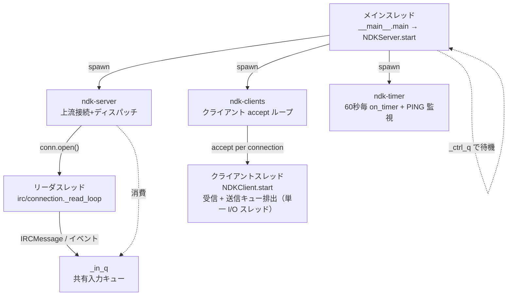
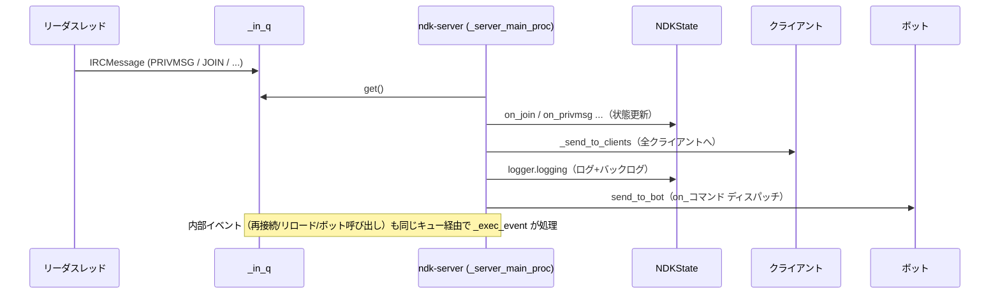
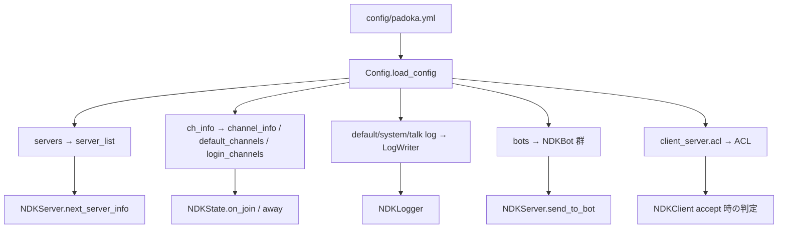

# Padoka 全体構成ガイド

本ガイドは Padoka（IRC クライアント/サーバー プロキシ）の内部構造 —
コンポーネントの役割、スレッドモデル、メッセージの流れ、ライフサイクル —
を解説します。設定項目は [configuration.md](configuration.md)、
ボット開発は [bot-development.md](bot-development.md)、
Docker 運用は [docker.md](docker.md) を参照してください。

---

## 1. Padoka とは

Padoka は IRC プロキシです。

- **上流**に本物の IRC サーバー（ircnet.ne.jp 等）へ 1 つの接続を確立し、
  1 つの nick で IRC に存在します。
- **下流**に IRC クライアントポート（デフォルト `6667`）を公開し、
  irssi / weechat 等の通常の IRC クライアントを多数接続できます。
- 上流と下流の往復メッセージを**プロキシ**し、チャネル状態（メンバー・
  モード・TOPIC）を追跡します。
- 受信メッセージを**ボットプラグイン**にディスパッチし、ボットから IRC へ
  応答させることもできます。



利点:
- IRC サーバーへの接続を 1 つに集約できる（マルチクライアント共有）
- クライアントがオフライン中でもプロキシは IRC に留まり、メッセージ履歴
  （`backlogbot`）やボット処理を継続できる
- ボットは IRC に常駐させるのではなく、プロキシ内で安全に動かせる

---

## 2. モジュール構成

```
src/padoka/
├── __init__.py       # VERSION, CREATED（バージョン定数）
├── __main__.py       # CLI エントリポイント（argparse / 信号 / sd_notify）
├── irc/              # IRC プロトコル層
│   ├── message.py    #   IRCMessage（parse/to_s）, ReplyName, Command
│   └── connection.py #   Connection（上流ソケット + リーダスレッド + フロード制御）
├── server.py         # NDKServer（オーケストレーター）, PrefixObject
├── client.py         # NDKClient（クライアント 1 接続のハンドラー）
├── config.py         # Config（YAML 読み込み / ログライター / ボット読込）
├── state.py          # NDKState, ChannelState（チャネル/メンバー/モード追跡）
├── logger.py         # NDKLogger, LogWriter, MessageStores（ログ + バックログ）
├── bot.py            # NDKBot（ボット基盤クラス）
├── acl.py            # ACL（クライアントアクセス制御）
├── notify.py         # NotifySocket（systemd sd_notify）
└── errors.py         # 例外階層
```

### 各コンポーネントの役割

| モジュール | 主なクラス | 責務 |
|-----------|-----------|------|
| `irc/message.py` | `IRCMessage` | IRC プロトコル文の**解析/生成**。数値応答名テーブル（`001`→`RPL_WELCOME`）でボットのディスパッチ名を作る |
| `irc/connection.py` | `Connection` | 上流 IRC サーバーへの **TCP/TLS 接続**。リーダスレッドが**単一 I/O スレッド**として受信 + 送信キュー排出を行う（SSLSocket の同時 read/write 防止）。PRIVMSG/NOTICE は同秒内に 2 回出ないようスロットル |
| `server.py` | `NDKServer` | **中核**。上流接続/再接続、クライアント受け入れ、往復プロキシ、Away モード、PING 監視、ボットへのディスパッチ、信号処理 |
| `client.py` | `NDKClient` | **クライアント 1 接続**のハンドラー。**SASL (PLAIN) / PASS / NICK / USER 認証**、MOTD、NAMES 再現、`/PADOKA` コマンド、双方向プロキシ。受信と送信キュー排出を 1 スレッドでポーリング |
| `config.py` | `Config` | **YAML 設定**の読み込みと派生値の生成（server_list / チャネル / ログライター / ボット / ACL） |
| `state.py` | `NDKState`, `ChannelState` | 現在の nick、参加チャネル、メンバー、モード、TOPIC の**追跡**。nick 衝突時の `nick_succ` |
| `logger.py` | `NDKLogger`, `*LogWriter`, `MessageStores` | チャネル別/システム/個人/デバッグの**ログ出力**と、メモリ内**バックログ**（`backlogbot` が利用） |
| `bot.py` | `NDKBot` | ボットの**基盤クラス**。`on_<event>` ハンドラーと送信ヘルパー（`send_notice` 等） |
| `acl.py` | `ACL` | クライアントの**ソースアドレス制御**（allow/deny、先頭一致） |
| `notify.py` | `NotifySocket` | **systemd sd_notify**（READY/WATCHDOG/RELOADING/STOPPING）。未設定時は no-op |
| `errors.py` | `NDK*` 例外 | 制御フロー用の**例外階層**（再接続/終了/フィルタ制御 等） |

### ボットプラグイン（plugins/）

`plugins/` には `NDKBot` を継承した 26 個のボットプラグインがあります。
ここでは**今回後から移植した 18 個**を、機能と主なイベントフック（どの
`on_<event>` を使うか）で一覧します。トリガー形式のボットは IRC 上で
`<トリガー> <引数>` のプライベート/チャネルメッセージで発動します。

#### PRIVMSG トリガー系

| プラグイン | 機能 | トリガー | 主なフック |
|-----------|------|---------|-----------|
| `xibot` | サイコロ振り・CoC 風 SAN ロール | `xi> 3d6` / `xi> 100` / `xi> character` / `xi> char` / `xi> san` | `on_privmsg` |
| `roulettebot` | ランダム抽選 / シャッフル / 乱数 | `roulette> 語句…` / `shuffle> 語句…` / `random> [上限]` | `on_privmsg` |
| `messagebot` | 伝言板（本人発言時に通知、JSON 永続化） | `伝言 <nick> <本文>` | `on_privmsg` |
| `googlebot` | Google CSE 検索 + 電卓（`api_key`/`cx` 必須） | `g> 語` / `google> 語` / `googlec> w1 w2` / `g:calc> 数式` | `on_privmsg` |
| `opensearchbot` | OpenSearch RSS の検索結果数を取得（`bot_name` 等設定で URL を指定） | `<bot_name>><語>`（例 `bing> 語`） | `on_privmsg` |
| `codesearchbot` | Debian コード検索（codesearch.debian.net） | `codesearch> 語` / `codesearch:<engine>> 語` | `on_privmsg` |
| `gonzuibot` | Ruby API / モジュール検索 | `gonzui> 語` / `gonzui:<engine>> 語` | `on_privmsg` |
| `tenkibot` | 気象庁の天気予報テキスト取得 | `tenki>` / `tenki> <都道府県名>` | `on_privmsg` |

#### 危険機能（PRIVMSG → サブプロセス実行、ACL 制限を強く推奨）

| プラグイン | 機能 | トリガー | 主なフック |
|-----------|------|---------|-----------|
| `evalbot` | 個人メッセージ宛に Python 式を評価（サブプロセス + 3 秒タイムアウト） | `padoka_eval` 宛ての WHISPER / `/PADOKA eval` | `on_client_privmsg` |
| `shellbot` | 個人メッセージ宛に shell コマンドを実行（サブプロセス + 3 秒） | `padoka_shell` 宛ての WHISPER / `/PADOKA shell` | `on_client_privmsg` |

#### JOIN トリガー系

| プラグイン | 機能 | 主なフック |
|-----------|------|-----------|
| `opshop` | 自分以外の参加者に自動で OP（+o）を付与 | `on_join` |
| `modemanager` | 参加時に設定ファイル/インライン定義のモード（`+o=*.jp` 等）をランダム遅延で適用 | `on_join` |

#### 接続時

| プラグイン | 機能 | 主なフック |
|-----------|------|-----------|
| `identifynickserv` | 上流接続完了時に NickServ へ `/identify` を自動送信 | `on_server_connected` |

#### Timer（定期）系

| プラグイン | 機能 | 主なフック |
|-----------|------|-----------|
| `checkbot` | 定期チェック用**基底クラス**（間隔超過で `check()` を呼ぶ。通常は継承して使う） | `on_timer` |
| `mailcheckbot` | Maildir / mh の新着メールチェック（biff）。`%{subject}s` 等のテンプレート通知 | `on_timer` |
| `githubissuesbot` | GitHub の issue / コメント更新・クローズを検出して通知（トークン任意） | `on_timer` |
| `rss_checkbot` | RSS / Atom フィードの新規エントリを検出して通知（初回はベースライン取得のみ） | `on_timer` |

#### ログアウト / 管理系

| プラグイン | 機能 | 主なフック |
|-----------|------|-----------|
| `autodumpbot` | 参加中チャネルの情報（名/タイミング/キー/初期モード）を YAML/JSON/text でファイルにダンプ。最後のクライアントログアウト時と `/PADOKA dump` で発火 | `on_join` / `on_part` / `on_mode` / `on_client_logout` / `on_padoka_command` |

補足:
- **PRIVMSG トリガー系**は `on_privmsg(prefix, ch, msg)` を実装し、`prefix.nick`
  （nick）・`ch`（チャネル名）・`msg`（本文）を受け取ります。
- **`on_client_privmsg(client, ch, msg)`** はクライアント経由で届いた
  PRIVMSG にのみ発火し、`evalbot` / `shellbot` が `NDKBotSendCancel` を投げて
  上流送信を止めることで「自分専用」を実現しています。
- 各プラグインの完全な設定項目はファイル内の docstring と
  [configuration.md](configuration.md) を参照してください。
- 移植を見送った 8 ボット（`crubybot` 等）とその理由は README.md の
  「移植を見送ったボット」を参照してください。

---

## 3. スレッドモデル

Padoka は 1 プロセス内で多数のスレッドを動かし、ソケットのブロッキング
読み取りとメッセージ処理を分離しています。



### スレッド一覧

| スレッド | 生成場所 | 役割 |
|---------|---------|------|
| **メイン** | `__main__.main` | `NDKServer.start()` を呼び、 `_ctrl_q` を待機。信号トラップを設置。終了/再起動制御 |
| **ndk-server** | `start()` | 上流 IRC への接続ループ。切断/ニック衝突/PONG 失敗で**再接続**。接続中は `_server_main_proc` でメッセージをディスパッチ |
| **リーダ**（`irc-reader`） | `Connection.open()` | 上流ソケットの**単一 I/O スレッド**: 短いタイムアウトで recv をポーリングし、受信ラインを `IRCMessage` として `_in_q` に投入。空き時間に送信キュー（`_out_q`）をソケットへ排出。EOF で `None` センチネル |
| **ndk-clients** | `start()` | `client_server.port` で `accept` 無限ループ。TLS ならハンドシェイク失敗時のみ拒否、ACL 判定、各接続でクライアントスレッドを生成 |
| **クライアント** | `_handle_client` | 1 つの IRC クライアント。**単一 I/O スレッド**（受信 + 送信キュー排出）でログイン（SASL /PASS /NICK/USER）、MOTD/NAMES 再現、受信ループ、`/PADOKA` 処理 |
| **ndk-timer** | `start()` | 約 60 秒毎に `on_timer` をボットへ発火。PING/PONG を確認し、5 回連続失敗で再接続要求 |

### TLS / SASL と単一 I/O スレッド

- **TLS**: `client_server.ssl_cert_file` / `ssl_key_file` を指定するとクライアント
  ポートは **TLS のみ**（平文接続は拒否される）。証明書読込失敗時は
  リスナー自体を開かない（fail closed）。ハンドシェイクはクライアント毎の
  スレッドで行う（タイムアウト 30 秒）ため、1 つの遅いクライアントが
  accept ループを止めない。
- **SASL**（ircv3）: `AUTHENTICATE PLAIN` をサポート。
  `base64(authzid NUL authcid NUL pass)` の pass を
  `client_server.pass` と照合し、成功で `904`、失敗で `907` を返して切断。
  `client_server.sasl: false` で無効化（`/PASS` のみ）。
  PLAIN はパスワードをクリアで送るため TLS と併用すること。
- **単一 I/O スレッド**: `SSLSocket` は別スレッドから同時 read/write すると
  レコードが失われるため、上流（`Connection`）もクライアント
  （`NDKClient`）も**1 つのスレッドが受信と送信キューの排出の両方を行う**
  ポンプ方式（短い recv タイムアウトでポーリング）になっています。

### 重要な設計：単一ディスパッチ

上流からの IRC メッセージと、内部イベント（再接続・設定リロード・ボット
呼び出しなど）は、**すべて同じ入力キュー `_in_q` に入る**ことになっています。
このキューを消費するのは `ndk-server` スレッド内の `_server_main_proc` の
みなので、チャネル状態（`NDKState`）への書き込みは**1 つのスレッドで
シリアル化**され、ロックが不要になります。

- IRC メッセージ: リーダスレッド → `_in_q`
- 内部イベント: `invoke_event(name, *args)` → `_in_q`（タプル `(EVENT, name, *args)`）
- 消費: `_recv_from_server` / `_exec_event`（`ndk-server` スレッド内）



---

## 4. メッセージの流れ

### 4.1 上流 → クライアント

```
IRC サーバー → リーダスレッド → _in_q → _server_main_proc
   ├─ PING  : PONG を返して続行
   ├─ JOIN/PART/NICK/QUIT/MODE/TOPIC/KICK : NDKState を更新
   ├─ 353/332/403 : NDKState を更新
   └─ その他:
        ① _send_to_clients  → 全クライアントへ転送
        ② logger.logging    → 該当チャネルログ + バックログ
        ③ send_to_bot       → ボットの on_<cmd> を呼ぶ
```

`_send_to_clients` は送信元の識別で prefix を調整します:
- **自分（プロキシ nick）のニック変更** → 旧ニックの prefix に書き換えて転送
- **自分宛のメッセージ** → 各クライアントの `add_prefix`（`自分のnick!ユーザー@host`）
- **その他** → そのまま転送

### 4.2 クライアント → 上流

```
IRC クライアント → NDKClient._recv_from_client → _send_from_client
   ├─ PING  : その場で PONG を返す
   ├─ QUIT  : クライアント接続を終了
   ├─ PRIVMSG/NOTICE:
   │     ├─ "/padoka <cmd>" なら /PADOKA コマンドとして処理
   │     └─ それ以外は:
   │           ① send_to_bot("client_privmsg", ...) → ボットが処理（NDKBotSendCancel で上流送信可否）
   │           ② send_to_server  → 上流 IRC へ送信
   │           ③ send_to_clients_otherwise → 他のクライアント + ボット + ログ
   └─ その他: send_to_server → 上流へ転送
```

### 4.3 ボット → IRC

ボットは `NDKBot` のヘルパーで送信します:

| ヘルパー | 挙動 |
|---------|------|
| `send_notice(ch, msg)` | NOTICE を上流へ + 全クライアントへ転送 |
| `send_privmsg(ch, msg)` | PRIVMSG を上流へ + 全クライアントへ転送 |
| `send_msg(cmd)` | 任意コマンドを上流へ（クライアント転送なし） |
| `change_mode(ch, mode, user)` | MODE を上流へ |
| `change_nick(nick)` | NICK を上流へ |

### 4.4 ボットへのディスパッチ（`send_to_bot`）

```python
selector = "on_" + (数値なら応答名 / コマンドなら lower)
# 例: PRIVMSG → on_privmsg, 001 → on_rpl_welcome, 353 → on_rpl_namreply
for bot in config.bots:
    if hasattr(bot, selector):
        bot.on_<selector>(prefix, *params)
    if hasattr(bot, "on_every_message"):
        bot.on_every_message(prefix, command, *params)
```

- IRC メッセージ系は `prefix`（`PrefixObject`: `.nick`/`.user`/`.host`）が先頭引数
- 合成イベント（`on_timer`, `on_client_login` 等）は引数なし or 特定引数
- ボット内の例外:
  - `NDKBotBreak` → 以降のボットへ渡さない（break）
  - `NDKBotSendCancel` → 上流/他クライアントへの送信をキャンセル
  - その他 → ログに記録して継続

---

## 5. ライフサイクル

### 5.1 起動

```
python -m padoka -c config/padoka.yml
   └─ NDKServer(rcfile)
        ├─ reload_config → Config（YAML 読込・ログライター・ボット生成）
        ├─ NDKState 生成
        └─ 信号トラップ設置（SIGINT/SIGTERM/SIGHUP/SIGUSR1/2）
   └─ start()
        ├─ ndk-server / ndk-clients / ndk-timer スレッド生成
        └─ メインは _ctrl_q を待機
```

### 5.2 上流へのログイン（ndk-server）

```
[PASS] → [NICK] → [USER] → 001(RPL_WELCOME) を待つ
   ├─ 433/437 (nick in use) → nick_succ で次候補 nick に変更し再試行
   ├─ ERROR → 再接続
   └─ 001 受信後:
        ├─ MODE（user mode が設定されていれば）
        ├─ 既定チャネルへ JOIN（channel_info / timing:startup）
        ├─ クライアント 0 件なら enter_away
        └─ on_server_connected をボットへ / sd_notify READY
```

### 5.3 Away モード

クライアント接続数の増減で on/off します。

```
最後のクライアントが切断 → enter_away
   ├─ AWAY（away_message）
   ├─ away_nick が設定されていれば nick を変更
   └─ login チャンネルから PART

最初のクライアントが接続 → leave_away
   ├─ AWAY（解除）
   ├─ 元の nick に戻す
   └─ login チャンネルへ再 JOIN
```

### 5.4 再接続

以下で発火します（いずれも `reconnect_to_server` イベント → 上流 PART → 再 connect）:
- 上流接続が切断されたとき
- **PONG 5 回連続で来ないとき**（ndk-timer の監視）
- クライアントから `/PADOKA RECONNECT` を受けたとき

`reconnect_delay`（デフォルト 150 秒）だけ待ってから再接続します。
サーバーが複数設定されている場合は `next_server_info` でランダム選択しローテーションします。

### 5.5 設定リロード / 再起動 / 終了

| きっかけ | イベント | 挙動 |
|---------|---------|------|
| `SIGHUP` | `reload_config` | Config を再読込、ボット再生成（IRC 接続は維持） |
| `/PADOKA RELOAD` | `reload_config` | 同上 |
| `/PADOKA RESTART` | `restart_program` | `NDKRestartProgram` を投げて再起動 |
| `SIGUSR1` / `SIGUSR2` | `invoke_bot sigusr1/2` | `on_sigusr1`/`on_sigusr2` を発火 |
| `SIGINT` / `SIGTERM` | `quit_program` | 全スレッド停止 → 終了 |
| `/PADOKA QUIT` | `quit_program` | 同上 |

---

## 6. 設定 → 実行への流れ

`Config`（YAML）が読み込む主な項目と、それがどこで使われるか:



- `channel_info` は**辞書**です（キー: 正規化済みチャネル名）。アクセスは
  必ず `.get(ch)` を使い、**呼び出し（`channel_info(ch)`）しない**でください。
- チャネル名の正規化: `identical_channel_name`（小文字化 + `[`→`{` 等）、
  `canonical_channel_name`（`!xxxxx` の安全チャネル部分を正規化）。
- ボットは `plugins_dir` 配下の `.py` を `importlib` で動的ロードし、
  `NDKBot` の子类をインスタンス化します。

---

## 7. セキュリティのポイント

| 項目 | 説明 |
|------|------|
| **ACL** | `client_server.acl` で接続元を制限。`deny all` + 個別 `allow` を推奨 |
| **evalbot / shellbot** | 個人メッセージ宛（`padoka_eval` / `padoka_shell`）のみに応答。任意コード/コマンドを実行するので**必ず ACL で信頼クライアント限定**に |
| **titlebot** | SSRF 防止で内部ホスト（localhost / RFC1918）を拒否。レスポンス 1MB 上限 |
| **googlebot 電卓** | `safe_calc` は ast 解析で**純数式のみ**評価（関数呼び出し・名前参照は拒否） |
| **パス** | `client_server.pass` を必ず設定 |

---

## 8. まとめ

- Padoka は「**上流 1 接続 + 下流 N クライアント**」のプロキシで、
  チャネル状態を `NDKState` で単一管理します。
- スレッドは「**ソケット読み取り**（リーダ/クライアント）」と「**状態更新**
  （ndk-server）」を分離し、状態への書き込みは `_in_q` を介して ndk-server
  に**シリアル化**するのが最大の設計原則です。
- 新規ボットは `NDKBot` を継承して `on_<event>` を実装し、
  YAML の `bots:` に追加するだけで有効になります。
